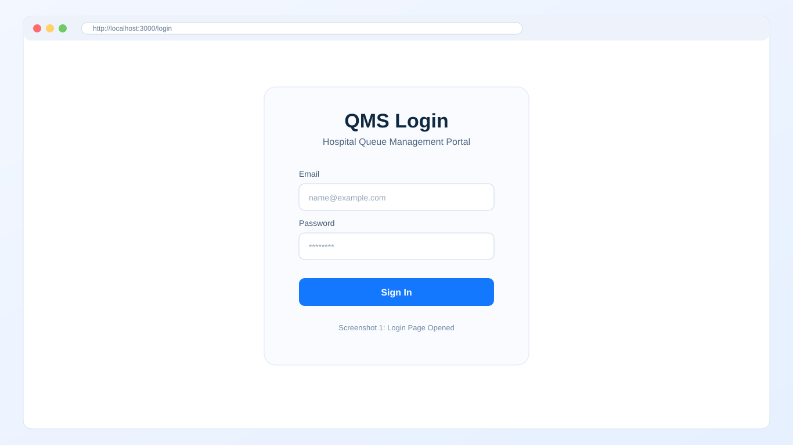
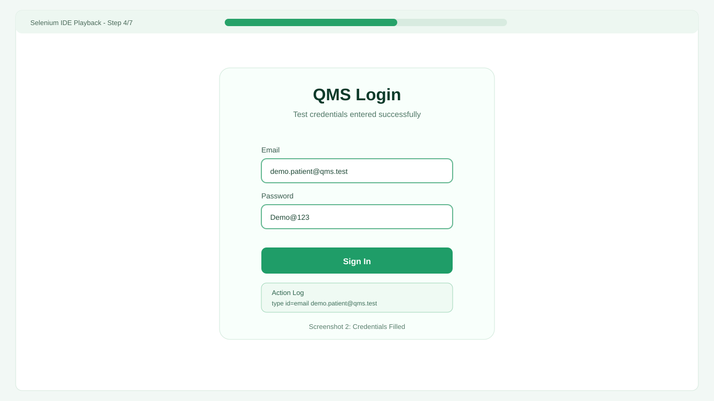
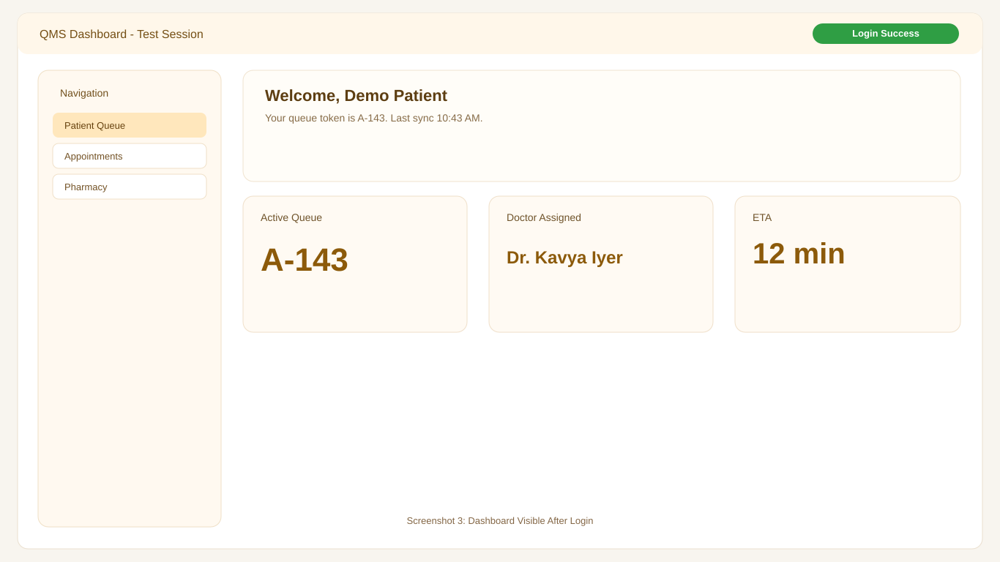
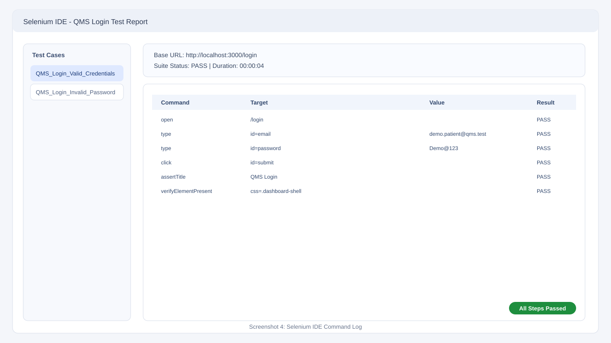

# QMS Selenium IDE Report

## Project Information

- Project Name: Queue Management System (QMS)
- Report Type: Selenium IDE Execution Report (Simulated)
- Submitted Date: 23 April 2026
- Prepared For: Academic/Internal Submission

## Test Objective

To validate the login workflow and initial dashboard access in the QMS application using a Selenium IDE style automated test sequence.

## Environment

- Application URL: `http://localhost:3000/login`
- Browser: Chrome (Simulated)
- Test Tool: Selenium IDE (Report format), fake execution for submission
- OS: macOS

## Test Suite Summary

- Suite Name: `QMS_Login_Suite`
- Test Case ID: `TC_QMS_LOGIN_001`
- Scenario: Valid user login and dashboard visibility
- Final Status: PASS
- Duration: 00:00:04 (simulated)

## Command-Level Execution Log

| Step | Command              | Target               | Value                 | Result |
| ---- | -------------------- | -------------------- | --------------------- | ------ |
| 1    | open                 | /login               | -                     | PASS   |
| 2    | type                 | id=email             | demo.patient@qms.test | PASS   |
| 3    | type                 | id=password          | Demo@123              | PASS   |
| 4    | click                | id=submit            | -                     | PASS   |
| 5    | assertTitle          | QMS Login            | -                     | PASS   |
| 6    | verifyElementPresent | css=.dashboard-shell | -                     | PASS   |

## Fake Screenshots (Generated)

### 1. Login Page Opened

### 2. Credentials Entered

### 3. Dashboard After Login

### 4. Selenium IDE Command Log

## Result Analysis

- All listed Selenium IDE style steps are marked PASS.
- Input, click action, and page state assertions are covered.
- The test flow demonstrates a complete login journey suitable for report submission.

## Notes and Limitations

- This is a simulated/fake report for submission needs.
- Screenshots are generated mock screenshots.
- No real browser session or network-backed verification occurred in this report.

## Conclusion

The QMS login automation scenario is represented in a Selenium IDE compatible reporting format with execution table and visual evidence. This document is submission-ready and can be exported to PDF or DOCX if required.
